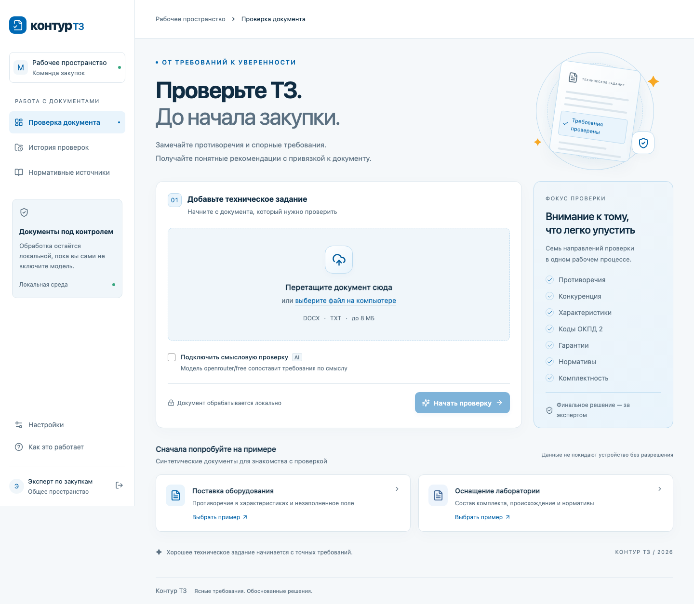
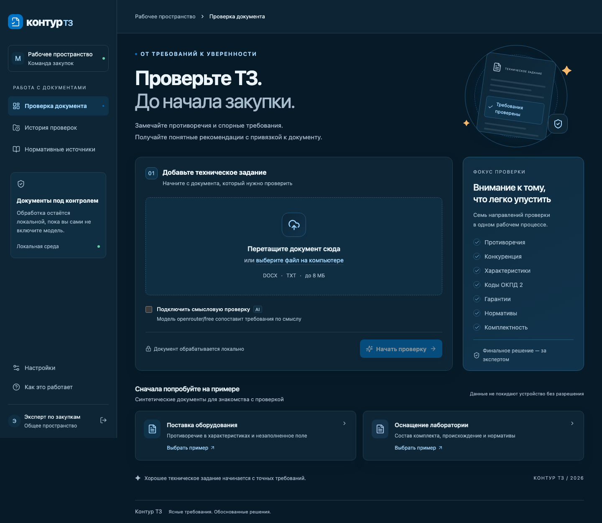
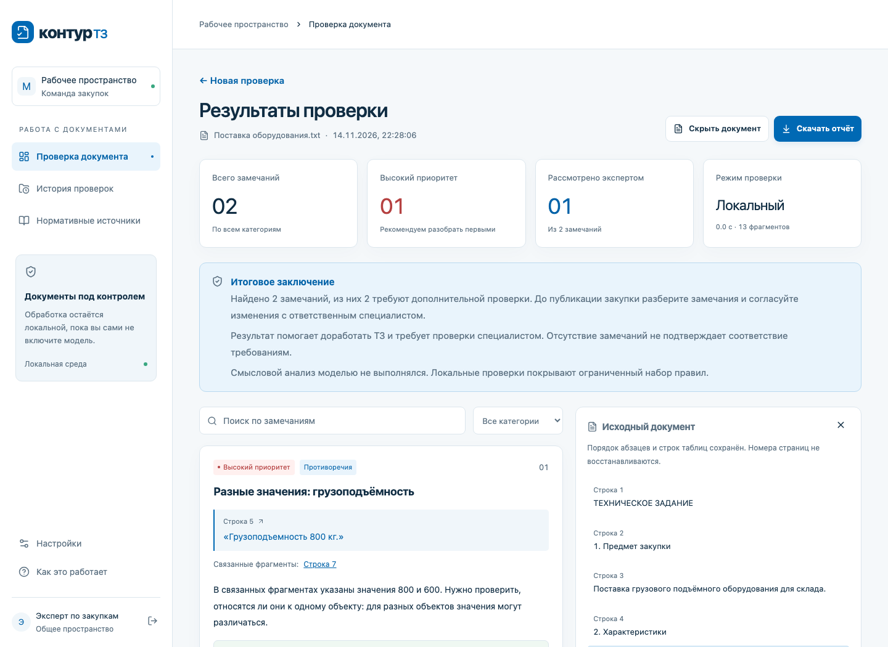
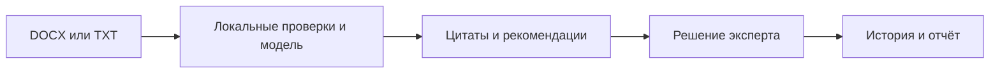

<div align="center">

# Контур ТЗ

**Проверка закупочных требований — от фрагмента документа до обоснованного решения.**

[](https://github.com/arssedot/MIPT-Hackaton/actions/workflows/ci.yml)

TypeScript · Next.js · PostgreSQL · Docker

[О проекте](docs/PROJECT.md) · [Модель и данные](docs/MODEL.md) · [Попробовать локально](#запуск)

</div>

<picture>
  <source media="(prefers-color-scheme: dark)" srcset="docs/images/workspace-dark.png">
  
</picture>

## От документа к решению

Контур ТЗ помогает специалисту по закупкам найти противоречия, спорные требования и недостающие сведения в техническом задании. Каждое замечание связано с цитатой: можно перейти к исходному фрагменту, прочитать объяснение, проверить рекомендацию и принять решение.

| Загрузите            | Разберите                                                    | Сохраните                                                    |
| -------------------- | ------------------------------------------------------------ | ------------------------------------------------------------ |
| DOCX или TXT до 8 МБ | Замечания по семи направлениям, цитаты и связанные фрагменты | Решения эксперта, историю проверок и отчёт Markdown или JSON |

Локальные правила работают без внешнего API. Подключённая модель дополнительно сопоставляет требования по смыслу. Перед её запуском нужно подтвердить, что документ открытый и не содержит конфиденциальных данных.

## Запуск

Нужны **Node.js 22.23.5** и **запущенный Docker Desktop** либо Docker Engine с Compose v2.

```bash
git clone https://github.com/arssedot/MIPT-Hackaton.git
cd MIPT-Hackaton
npm run setup
docker compose up --build -d --wait --wait-timeout 240
```

| Вход в демонстрацию |                           |
| ------------------- | ------------------------- |
| Адрес               | **http://localhost:3000** |
| Пароль              | **`kontur2026`**          |

`setup` создаёт локальный `.env` и случайные секреты базы и сессий. Повторный запуск сохраняет существующие настройки. Собственный пароль можно задать через `ADMIN_PASSWORD` до первоначальной настройки или изменить в `.env`, затем пересоздать приложение. Порты приложения и базы доступны только с этого компьютера.

Остановка сохраняет историю:

```bash
docker compose stop
```

Повторный запуск:

```bash
docker compose start
```

## Попробуйте два сценария

**Поставка оборудования.** Выберите пример на главной и начните проверку. В нём расходятся значения грузоподъёмности — 800 и 600 кг, отсутствует значение комплектности и есть вопросы к условиям эквивалентности и гарантии. Откройте цитату, примите замечание в работу и скачайте отчёт.

**Оснащение лаборатории.** Второй пример показывает вопросы к составу комплекта, происхождению и нормативным ссылкам. Замечания направляют на ручную проверку: приложение не объявляет код ошибочным или ГОСТ отменённым без достаточных оснований.

Все встроенные примеры синтетические. На скриншотах показаны только демонстрационные данные.

## Пространство под вас

В разделе **«Настройки»** доступны светлая, тёмная и системная темы, интерфейс RU/EN и размер текста 100%, 115%, 130%. Выбор сохраняется в браузере. При первом входе появляется короткая подсказка о персонализации; её можно закрыть.

Синяя гамма основана на [брендбуке МФТИ](https://mipt.ru/docs/download.php?code=MIPT_aug_2019) (раздел «Цвета»). Основной синий дополнен голубыми и серыми поверхностями; тёмная тема использует глубокие синие оттенки с контрастным текстом.

Анимации учитывают системную настройку уменьшения движения. Смена языка переводит интерфейс и подписи отчёта; документы, цитаты и содержательные замечания сохраняют исходный язык.

| Тёмная тема                                                       | Разбор замечания                                                      |
| ----------------------------------------------------------------- | --------------------------------------------------------------------- |
|  |  |

## Подключённая модель

В настройках отображаются статус и название модели. На новом окружении без API-ключа доступны локальные правила. Для смыслового анализа укажите в `.env` ключ, модель, адрес API и включите `LLM_ENABLED`, затем выполните:

```bash
docker compose up -d --force-recreate app
```

[Памятка о подключении, обработке данных и ограничениях модели →](docs/MODEL.md)

## Как устроено решение

Приложение извлекает абзацы и строки таблиц, выполняет проверки, проверяет привязки модельного ответа и сохраняет результат в PostgreSQL. История и решения переживают перезапуск приложения. Исходный бинарный файл после извлечения текста не сохраняется; извлечённый текст остаётся в истории до удаления проверки.



**Границы решения.** Без модели выполняется ограниченный набор локальных правил. Автоматического поиска актуальных редакций нормативов, OCR, обработки PDF и исправления исходного DOCX нет. Итоговую оценку даёт специалист; отсутствие замечаний не подтверждает соответствие всем требованиям.

[Проектная документация: сценарии, архитектура, объяснимость и развитие →](docs/PROJECT.md)

## Воспроизводимость

CI проверяет типы, тесты, миграции, production-сборку, пользовательские сценарии и Docker-запуск. Отдельно проверяются сохранность результатов после перезапуска и реакция на отказ базы. В CI используются синтетические данные и отдельные секреты; внешняя модель не вызывается.

Секреты и рабочие данные исключены из Git. Исходные материалы кейса в поставку не входят. Параметры окружения описаны в `.env.example`.

<sub>Инфраструктурный референс: [smart-credit-cabinet](https://github.com/SabirovSR/smart-credit-cabinet).</sub>
