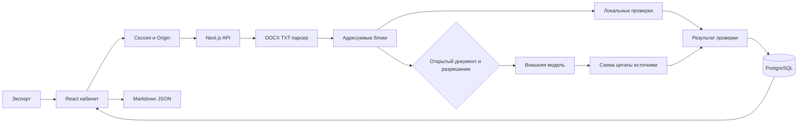

# Архитектура Контур ТЗ

Контур ТЗ — модульный монолит для локального запуска с последующим переносом на сервер. Один Next.js-процесс обслуживает React-интерфейс и HTTP API; PostgreSQL обеспечивает долговременное хранение. Сборка не требует доступа к БД или ключу модели.

## Модули

`src/contracts` задаёт типы документов, фрагментов и замечаний и Zod-схему ответа модели. `src/server/documents` разбирает DOCX как OOXML, не преобразуя его в HTML, и читает UTF-8 TXT. DOCX обрабатывается как последовательность абзацев и таблиц. Табличная строка становится единым блоком с ячейками через `|`. Номера страниц зависят от рендеринга Word и не заявляются.

`src/server/analysis/local.ts` выполняет ограниченные структурные проверки и сопоставляет значения одного атрибута в разных фрагментах. Результаты не привязаны к именам файлов и эталонным исправлениям. Часть локальных правил предметная, например сравнение типов лифта; это явно ограничивает универсальность локального режима.

`src/server/analysis/model.ts` отвечает за универсальный смысловой анализ. Провайдер выбирается окружением, ключ не попадает в браузер. Полный текст отправляется только при `useModel=true` и `isPublic=true`. Документ передаётся как недоверенные данные, не как системные инструкции. Модель получает ограниченный каталог источников. Это не RAG по актуальной нормативной базе: новый источник из ответа модели отклоняется.

Модель обязана вернуть точную цитату и существующие идентификаторы блоков. Некорректный JSON, схема, цитата или источник отклоняют весь модельный ответ. Локальный результат при этом сохраняется с предупреждением. Любое замечание модели остаётся задачей ручной проверки, даже если модель заявила уверенность. Успешная проверка цитат подтверждает место, но не истинность интерпретации.

`src/server/auth.ts` подписывает 12-часовые сессии HMAC, проверяет пароль постоянным по длине хешированным сравнением и контролирует Origin изменяющих запросов. Ограничитель частоты хранится в памяти одного процесса. Для нескольких экземпляров потребуется общий limiter.

`src/app/api` оркестрирует операции. `src/components/workspace.tsx` отображает рабочее пространство, фильтры, оригинальные фрагменты и решения. `Prisma Review.data` хранит версионируемый JSON результата; отдельные колонки id/name/createdAt нужны для адресации и истории. Изменение решения выполняется в транзакции с блокировкой строки, чтобы избежать потери параллельных изменений.

## Данные и жизненный цикл

1. Эксперт входит по общему паролю. Учётных записей и разграничения данных по пользователям в MVP нет.
2. Файл до 8 МБ передаётся серверу. DOCX допускает распакованный XML до 12 МБ. Лимит после разбора — 160 000 символов, 3000 блоков.
3. Формируется список блоков с id, section, location, kind и text. Изменения Word: удалённый текст пропускается, вставленный учитывается. Комментарии, колонтитулы, сноски и текст изображений не анализируются.
4. Выполняются локальные проверки и, по выбору эксперта, внешний анализ с таймаутом 90 секунд. Входные примеры кейса не передаются автоматически.
5. Результат сохраняется в PostgreSQL одной записью. Исходный ZIP/бинарный файл не сохраняется. Удаление проверки удаляет извлечённый текст и все решения в ней.
6. Эксперт рассматривает замечания и скачивает отчёт. Статус принятия не изменяет исходное ТЗ; коррекция делается в редакторе документа.

## Инфраструктура

Dockerfile содержит стадии `deps`, `build`, `init`, `runner`. Runner работает непривилегированным пользователем `node`. Compose запускает БД, применяет миграции отдельным init-контейнером, затем стартует приложение. Сервисы публикуются только на loopback, данные — в именованном томе. Docker не получает исходные документы и локальные секреты в контексте сборки.

Readiness проверяет PostgreSQL и отвечает 503 при отказе; liveness остаётся 200, пока работает HTTP-процесс. Внешний API не влияет на readiness: приложение сохраняет локальный режим при его отказе. Очередь, фоновый worker и повтор отправки модельных запросов не реализованы: анализ синхронный, один запрос не более 120 секунд на уровне декларации маршрута; фактический timeout на сервере задаёт оператор.

## Решения и развитие

Выбран PostgreSQL вместо файлового хранилища, чтобы перенос и резервное копирование выполнялись стандартными средствами, а результаты переживали перезапуск. JSON позволяет менять контракт на хакатоне; до промышленного использования нужна версия схемы и миграция исторических JSON.

Следующий этап: управляемый нормативный корпус с датами редакций, извлечение типизированных сущностей по позициям, retrieval с доказательствами, golden-набор независимых ТЗ, метрики precision/recall и доля непривязанных выводов. Затем — очередь заданий, пользователи/роли, журнал изменений, DOCX-экспорт исправлений и OCR при подтверждённой потребности.
