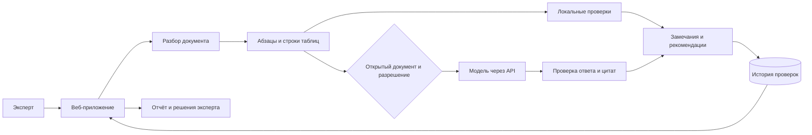

# Контур ТЗ

Контур ТЗ помогает специалисту по закупкам проверить техническое задание до публикации закупки. Пользователь получает замечания с цитатами, связанными фрагментами, объяснениями и рекомендациями, затем принимает решение по каждому замечанию и сохраняет отчёт.

## Задача и пользователи

Основной пользователь — сотрудник закупок или технический эксперт, которому нужно согласовать требования к товару или работе. В одном документе могут расходиться характеристики, отсутствовать параметры, смешиваться условия гарантии или требоваться проверка нормативных оснований. Система собирает такие вопросы в единый список для предметного разбора.

Решение предназначено для поддержки эксперта. Оно не выдаёт юридическое заключение и не подтверждает соответствие документа всем требованиям.

## Сценарий работы

1. Войти в рабочее пространство и загрузить DOCX или TXT.
2. Выбрать локальную проверку или дополнить её анализом подключённой модели.
3. Разобрать замечания: открыть цитату, посмотреть связанные фрагменты и проверить рекомендацию.
4. Принять замечание в работу либо отклонить. Решение сохраняется в истории.
5. Скачать Markdown-отчёт или полный результат в JSON.

На первом экране есть два синтетических примера. Они позволяют пройти сценарий без собственных документов. Настройки оформления, языка и размера текста находятся в отдельном разделе; выбор сохраняется в браузере.

## Что проверяется

| Направление    | Пример вопроса                                                          |
| -------------- | ----------------------------------------------------------------------- |
| Противоречия   | Совпадают ли требования к одному объекту в описании и спецификации?     |
| Конкуренция    | Обоснованы ли указания модели, происхождения и условий эквивалентности? |
| Характеристики | Достаточно ли определены параметры и границы требований?                |
| Коды ОКПД 2    | Нужна ли отдельная проверка классификации товара или комплекта?         |
| Гарантии       | Согласованы ли объект гарантии и событие начала её срока?               |
| Нормативы      | Проверены ли статус и применимость указанного стандарта?                |
| Комплектность  | Заполнены ли характеристики и раскрыт ли состав поставки?               |

Локальный режим покрывает ограниченный набор правил. Модель дополнительно сопоставляет смысл и связи между требованиями. Предметная и нормативная оценка остаётся за специалистом.

## Архитектура решения

Приложение использует TypeScript, Next.js и PostgreSQL. Интерфейс и серверная обработка работают в одном приложении, база сохраняет извлечённый текст, замечания и решения. Docker Compose обеспечивает воспроизводимый локальный запуск. Исходный бинарный документ после разбора не сохраняется.

## Объяснимость и работа с данными

Каждое замечание связано с конкретным фрагментом документа. Для противоречий могут быть указаны дополнительные фрагменты. Ответ модели проверяется на структуру, существование адресов, точное вхождение цитат и допустимые источники. Невалидный ответ отклоняется; локальный результат сохраняется с предупреждением.

Все выводы модели требуют проверки экспертом. Ссылка на каталог стандартов или классификатор служит маршрутом ручной проверки и сама по себе не доказывает нарушение. Актуальность каждого ГОСТ, редакции закона и конкретного кода автоматически не подтверждается.

Передача текста во внешний API требует отдельного подтверждения, что документ открытый. При выключенной смысловой проверке текст обрабатывается в локальном окружении. Переключение языка интерфейса не переводит цитаты и замечания и не отправляет новых запросов модели.

## Примеры использования

**Поставка оборудования.** В двух разделах синтетического ТЗ одному подъёмному оборудованию заданы 800 и 600 кг. Результат связывает оба фрагмента и предлагает согласовать требование. Пример также содержит незаполненную комплектность, вопросы к условиям эквивалентности и началу гарантии на работы. Полнота их выявления зависит от режима проверки; локальные правила покрывают ограниченный набор требований.

**Оснащение лаборатории.** Несколько самостоятельных приборов указаны одним комплектом. Результат предлагает проверить его состав и классификацию, допустимость ограничения происхождения и актуальность указанного стандарта. Ошибочность кода или отмена ГОСТ не заявляются как установленный факт.

## Ограничения

- Поддерживаются DOCX и TXT до 8 МБ; сканы, PDF и OCR не входят в текущий объём.
- Привязка выполняется к абзацам и строкам таблиц, номера страниц Word не восстанавливаются.
- Без подключённой модели выполняется ограниченный набор локальных проверок.
- Автоматического поиска по актуальной нормативной базе и исправления исходного DOCX нет.
- Общее рабочее пространство доступно всем пользователям с его паролем.
- Метрики полноты и точности на независимом экспертном корпусе пока не получены.

## Проверка и развитие

Автоматические проверки покрывают разбор таблиц и чисел, повреждённые файлы, привязку цитат, отсутствие отдельных ложных срабатываний, пользовательский сценарий, персонализацию и сохранность данных после перезапуска. CI отдельно собирает и запускает Docker-окружение.

Следующие шаги — независимая экспертная оценка, типизированное описание позиций и характеристик, нормативный корпус с датами редакций, сравнение версий ТЗ и экспорт согласованных исправлений. Дальнейшее развитие ориентировано на снижение пропусков и ложных замечаний, а не на формальную замену эксперта.
